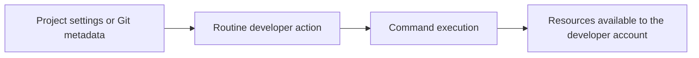

# crazy-bastard (`cb`)

`cb` is an experimental Rust CLI for reducing what a selected command can
access on macOS. It combines a private execution session with explicit file
inputs, a minimal environment and an operating-system access policy. It also
provides a separate Git adapter that suppresses automatic hooks.

The long-term goal is an isolated environment for applications, including GUI
apps, backed by a disposable VM. **The current release supports only
single-process, noninteractive CLI programs.** GUI applications, interactive
terminals, package installations and workflows requiring subprocesses are not
supported yet.

## The finding behind the project

A repository contains more than application source. Editors and Git also read
configuration and metadata, and some of that configuration can start programs.
Reviewing the Rust, JavaScript or Python application code alone can miss those
execution paths.

Two examples explain the problem:

- **Editor terminal configuration.** Workspace settings can change a terminal
  profile's executable, arguments or environment. Starting a familiar-looking
  terminal can therefore run different instructions from the ones the developer
  expects. VS Code provides Workspace Trust and Restricted Mode to limit
  execution features while unfamiliar content is being reviewed.
- **Git hook configuration.** Git can invoke hooks during ordinary operations,
  including checkout and commit. Hook files and a configured `core.hooksPath`
  deserve review before operating on unfamiliar local Git metadata.

A normal clone does not copy another repository's client-side hooks. Archives
containing Git metadata, setup scripts and local configuration are separate
ways hooks can appear. Tracked editor settings can arrive with an ordinary
clone. These are different entry points, and both need a clear trust decision.



Once a command runs as the developer, it may reach files and services available
to that account. Owner-only file permissions do not separate a user from a
process running as that same user. Actual access still depends on OS privacy
controls, encryption, permissions and service approvals.

A suspicious launch instruction establishes an execution risk. Confirming that
it ran, determining what it accessed and proving that data left the machine are
separate questions. This repository documents the general problem and defensive
controls; it contains no personal incident timeline, account inventory, attacker
infrastructure or incident-specific payloads.

References: [VS Code terminal profiles](https://code.visualstudio.com/docs/terminal/profiles),
[Workspace Trust](https://code.visualstudio.com/docs/editing/workspaces/workspace-trust),
[Git hooks](https://git-scm.com/docs/githooks), and
[how client-side hooks are distributed](https://git-scm.com/book/en/v2/Customizing-Git-Git-Hooks).

## Two distinct operating modes

| Command | What it does | Boundary |
| --- | --- | --- |
| `cb run --experimental-seatbelt -- COMMAND` | Starts a selected command in a private session with a restrictive macOS policy. | Experimental single-process containment; shares the host kernel. |
| `cb git ...` or `cb-git ...` | Runs the host Git executable with hooks and fsmonitor suppressed. | A Git execution policy, **not** filesystem or network isolation. |
| `cb doctor` | Reports platform, backend availability and unsupported features. | Informational; it does not launch a program or certify the host. |

The Git adapter can still use normal host files, network access and configured
Git authentication. Do not treat it as equivalent to `cb run` or as approval to
build an unfamiliar project.

## What the launcher restricts

These controls apply to `cb run`:

| Area | Current behavior |
| --- | --- |
| Home and temporary files | A fresh private session supplies `HOME`, `TMPDIR` and a working directory. The real home directory is not granted. |
| Inputs | Only explicitly selected regular files are copied in. No host directories are mounted or copied recursively. |
| Environment | An allowlist replaces the parent environment. Tokens, loader variables and agent socket variables are not inherited. |
| Open descriptors | Extra inherited file descriptors are marked close-on-exec before the program starts. |
| Network and services | The policy grants no TCP/Unix socket network access or Mach service lookup. Synthetic tests exercise network denial. |
| Process creation | Fork and spawn are denied. Programs requiring child processes are unsupported. |
| Lifetime | The default wall limit is 30 seconds. SIGINT, SIGTERM, deadline expiry or output failure stops and reaps CB's owned command. |
| Output | Terminal control and bidirectional control characters become visible text. Each output stream is limited to 8 MiB. |
| Cleanup | The private session is removed on normal completion. Cleanup failures are reported. |

Some system executable/library paths and filesystem metadata remain readable.
CB does not hide the machine's identity or make the host invisible. Explicit
input files are deliberately available to the launched program, so do not select
files containing secrets unless that disclosure is intended.

## Build and try

The project pins Rust 1.98.1 and commits its dependency lockfile. The launcher
requires macOS and `/usr/bin/sandbox-exec`.

```sh
git clone https://github.com/mambisi/crazy-bastard.git
cd crazy-bastard
cargo build --locked --release --bin cb

./target/release/cb doctor
./target/release/cb run --experimental-seatbelt -- /bin/echo hello
./target/release/cb run --experimental-seatbelt -- /usr/bin/env
```

The environment example displays the session's minimal environment. It does
not receive the invoking shell's environment. Stdin is disconnected, so this
release does not support interactive applications or piping input into them.
Arguments are passed directly; a shell is used only when explicitly selected.

Before the requested program starts, CB checks that the policy can launch a
harmless compatibility probe. A rejected policy stops the launch. CB does not
automatically widen permissions or retry without isolation. This compatibility
check is not proof that every possible program is safely contained.

### Give a command one input file

```sh
printf 'hello from a fixture\n' > example.txt

./target/release/cb run --experimental-seatbelt --input ./example.txt -- \
  /bin/sh -c 'read -r line < "$CB_INPUT_DIR/000-example.txt"; printf "%s\n" "$line"'
```

Input names receive a numeric prefix inside `CB_INPUT_DIR`. The original file
is not mounted or modified. Up to 32 inputs are accepted, with a combined size
limit of 64 MiB. Symlinks, special files and directory inputs are refused.
Non-system executables are also copied into the session, with a 256 MiB limit.
Programs needing libraries outside the allowed system paths may fail.

Use `--timeout SECONDS` before `--` to choose a wall limit from 1 to 3600 seconds.
There is no network opt-in or unrestricted execution flag in this release.

### Optional CLI installation

```sh
cargo install --path . --locked --bin cb
ln -s cb "$HOME/.cargo/bin/cb-git"
```

Ensure the installation directory is on your `PATH`. A symlink or copy named
`cb-git` dispatches directly to the Git adapter. The test probe is not installed
by this command.

## Git hooks and VS Code

```sh
cb git -C /path/to/repository status
cb git -C /path/to/repository switch topic
```

The adapter invokes `/usr/bin/git` with command-level hook suppression,
fsmonitor disabled and the `ext` protocol disabled. Fixed policy options follow
caller global options, so repository settings and earlier `-c` flags cannot
re-enable the covered hooks. Known hook-event switches also apply on Git versions
that support configured hooks. Git 2.36 or newer is required for fsmonitor
compatibility.

Aliases, explicit `git hook` execution and external Git subcommands are refused.
Reviewed hooks used for linting, signing workflows or Git LFS uploads do not run
through this adapter. Git filters, merge drivers, credential helpers, editors,
transports and explicitly requested commands are **not sandboxed** by it.

For VS Code, set the user-level `git.path` to the absolute path of `cb-git` and
reload the window after saving work. This routes that Git extension's operations
through the adapter; it does not intercept terminals, other editors or remote
hosts. CB does not itself sandbox the VS Code GUI.

Keep unfamiliar workspaces in Restricted Mode. Review previously trusted folders
and avoid trusting a broad parent containing arbitrary downloaded projects.
[The editor hardening guide](docs/editor-hardening.md) explains the settings,
Git configuration precedence and the tradeoffs of disabling hooks. CB does not
change host settings automatically when it starts.

## Limits and the VM direction

The current backend uses macOS's deprecated/private `sandbox-exec` interface and
shares the host kernel. It is an experimental prototype, not a production
malware-analysis environment or a substitute for an independently reviewed
security boundary. Do not use this release to detonate real malware.

It does not defend against an already compromised host, kernel exploits, every
covert channel or comprehensive CPU, memory and disk exhaustion. SIGKILL, power
loss or a host crash can leave session data or a contained command behind.

The next major boundary is a disposable VM with its own disk, no shared home,
no clipboard or agent forwarding, and explicit brokers for file/network access.
That backend and GUI application support are **not implemented**. Read the
[security model](docs/security.md) for the current grants, denials and failure
behavior.

## Validation

```sh
cargo fmt --all -- --check
cargo clippy --locked --all-targets --all-features -- -D warnings
cargo test --locked --all-features
```

Native isolation checks are opt-in because they require macOS sandbox permission
and may be blocked by a parent sandbox:

```sh
cargo test --locked --features test-probe --test macos -- \
  --ignored --test-threads=1
```

The checks use synthetic files, owned dummy processes and local sockets. They
cover argument handling, environment isolation, input routes, descriptor
handling, network denial, process restrictions, cleanup, deadlines and hook
suppression. `cb-test-probe` is built only with the explicit `test-probe` feature;
it is not part of a normal release. Passing these checks does not establish
coverage of every kernel interface.

## Publication privacy

The public findings are generalized. Personal paths, account inventories,
incident timelines, captured system state, attacker endpoints and sensitive
reproduction material stay outside this repository. Examples use synthetic
values, and no credentials or private audit reports belong in the source tree.
