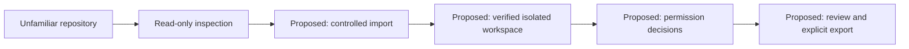

# crazy-bastard (`cb`)

CB is an experimental Rust tool for reviewing unfamiliar repositories and choosing
an explicit execution boundary. The intended workflow is **inspect, import into
an isolated workspace, review permissions, then export or discard changes**.

Today it provides a bounded static inspector, an experimental macOS CLI sandbox,
and explicit host editor/Git helpers. **The isolated editor workspace and
approval TUI are not implemented.** `cb code .` refuses launch until a verified
workspace runtime is integrated; it never falls back to a host window.

## Is CB worth building?

A new general-purpose sandbox, firewall or approval engine is not the recommended
scope. Existing tools already cover those functions. OpenShell also documents
network approvals and remote editor connections, so those features alone are
not a reason to build CB.

The narrower experiment is a repository-review workflow using an existing
runtime. It must demonstrate safer defaults or lower user error than using that
runtime directly. If it only adds new command names, stop the expansion.
[The researched feature comparison](docs/comparison.md) covers OpenShell, nono,
Lima, LuLu, Little Snitch, Santa, sandbox-runtime and Agent Safehouse. It compares
documented features, not independently verified security.

[The product design](docs/product.md) defines the command migration, proposed
workspace lifecycle, runtime reuse and go/no-go experiment.

## Why repository review needs more than source inspection

Editors and Git consume configuration that can launch programs. Workspace
terminal profiles can select another executable, arguments or environment.
Tasks and debugger settings can start commands. Git can invoke hooks during
ordinary operations, and a custom `core.hooksPath` can redirect hook discovery.

A normal clone does not copy another repository's client-side hooks. Archives
containing Git metadata, setup scripts and local configuration are separate
ways hooks can appear. Tracked editor settings can arrive with an ordinary clone.
These paths need a trust decision before normal developer tools consume them.



A suspicious launch instruction establishes an execution risk. Whether it ran,
what it accessed and whether data left the machine are separate questions.
Processes running as the same user can reach that account's resources, subject
to OS privacy controls, encryption and service approvals. A fresh profile or
owner-only file permissions do not provide an OS isolation boundary.

References: [VS Code terminal profiles](https://code.visualstudio.com/docs/terminal/profiles),
[Workspace Trust](https://code.visualstudio.com/docs/editing/workspaces/workspace-trust),
and [Git hooks and their distribution](https://git-scm.com/book/en/v2/Customizing-Git-Git-Hooks).

## Commands and boundaries

| Command | Behavior and status |
| --- | --- |
| `cb inspect DIRECTORY` | Static launch-surface review, compiled with `--features scanner`. No project commands run. |
| `cb run --experimental-seatbelt -- COMMAND` | Experimental single-process macOS isolation, sharing the host kernel. |
| `cb code [DIRECTORY]` | Isolation-required editor workspace; currently unavailable and refuses launch. |
| `cb host code [--monitor] [DIRECTORY]` | Explicit hardened host window. Original files remain editable; host access is not isolated. |
| `cb host git ...` | Host Git with hooks/fsmonitor suppressed. Configured host facilities still require trust. |
| `cb doctor` | Reports shipped capabilities without executing tools or certifying security. |
| `cb-git ...` | Existing executable-name adapter for the same host Git policy. |

Use `cb COMMAND --help` or `cb host code --help` for details.

Migration: the former host `cb code .` is now `cb host code .`. The old `cb git`
spelling returns an error pointing to `cb host git` without running Git.
`cb-git` remains compatible. `cb scan` is a read-only alias for `cb inspect`.
`cb code --vm .` retains isolation-required intent; `--vm` is refused in host mode.

## Build and try

Rust is pinned to 1.98.1. **Default and static-scanner builds use only `libc`.**
The optional `review` feature adds exactly pinned `ast-grep-core` and four grammar
packages, with all transitive versions/checksums committed in `Cargo.lock`.
The macOS monitor uses a project-owned C shim compiled with Apple's tools/SDK.
The optional parser compiles Tree-sitter and its C grammars from the locked
crates. A future runtime or image remains a dependency even if it is absent
from `Cargo.lock`.

```sh
git clone https://github.com/mambisi/crazy-bastard.git
cd crazy-bastard
cargo build --locked --release --bin cb

./target/release/cb doctor
./target/release/cb --help
./target/release/cb run --experimental-seatbelt -- /bin/echo hello
```

The default build excludes the inspector. Enable it explicitly:

```sh
cargo build --locked --release --features scanner --bin cb
./target/release/cb inspect --json /path/to/unfamiliar-repository
```

Optional CLI installation:

```sh
cargo install --path . --locked --bin cb
ln -s cb "$HOME/.cargo/bin/cb-git"
```

Ensure the installation directory is on `PATH`. A symlink or copy named `cb-git`
dispatches to the host Git adapter. The test probe is not installed by this command.

## Inspect without executing

The `scanner` feature checks these surfaces at the selected root:

- `.vscode/settings.json`, `tasks.json` and `launch.json`: terminal/tool overrides,
  trust-related settings, automatic tasks, debugger launches and command inputs.
- Top-level `*.code-workspace` files and their embedded settings/tasks/launch.
- Local `.git/config`, `.git/config.worktree` and non-sample `.git/hooks` files:
  hooks, fsmonitor, aliases, includes, filters and selected executable helpers.
- `package.json` scripts and conventional Rust `build.rs` presence.

The inspector starts no Git, shell, editor, build, package tool or network request.
Reports contain stable rule IDs, relative paths, locations and generic reasons,
with command/configuration values omitted. File names can still be private.
A finding may describe legitimate configuration needing review.

Exit status is 0 for no findings in scope, 1 for findings and 2 for an incomplete
scan or invalid invocation. Incomplete takes precedence. Reports never establish
that a project is malware-free. This is not a dependency-CVE, secret or general
source-code audit.

Descendant links, special files, ambiguous JSON, unreadable/oversized inputs and
unsupported Git syntax produce incomplete results. Includes, custom hook paths,
external Git metadata and workspace references are not followed automatically.
Use `cb inspect --git-dir DIRECTORY` or `cb inspect --hooks DIRECTORY` for explicit
metadata/hook reviews. Nested projects, global configuration, installed extensions
and running processes are outside scope. See [the inspector guide](docs/scanner.md).

## Optional AST and Codex CLI review

Build with `--features review` (includes `scanner` and the locked AST library).
Plain `cb inspect` stays static. Select source files explicitly to run bundled
`ast-grep` patterns and optionally add a Codex CLI review:

```sh
cargo build --locked --release --features review --bin cb
./target/release/cb inspect /path/to/repository \
  --source src/app.js \
  --with codex --harness-bin /trusted/native/codex
```

This uses your existing private Codex CLI `auth.json` login in place; **no API key
is required**. Use the native Codex binary behind any npm/Bun launcher.
No separate ast-grep installation is needed. CB runs its bundled parser in a
separate sandboxed copy of itself. An explicit `--ast-grep /absolute/native/binary`
override remains available, with its version outside Cargo.lock. No runtime tool
is automatically downloaded or installed.
The optional review sends selected source and AST matches to OpenAI and can
consume paid usage. Omit `--with` and `--harness-bin` for local AST checks only:
`cb inspect DIRECTORY --source src/app.js`. See the review guide for dependency
versions and the full optional dependency budget.

Both stages run in separate experimental macOS Seatbelt sessions. The Codex
profile allows inference networking and read-only access to its login file,
requests disabled tools/configuration discovery, and denies subprocess creation
and repository/host-home reads. Fixed developer instructions treat source as
untrusted data; validated findings must cite exact snapshot evidence. These
controls reduce exposure; **they cannot guarantee prevention of prompt injection**.
Model output grants no permissions and makes no fixes. Authentication refresh,
keychain-only logins and CLI versions may be unsupported; failure has no host
fallback. Other harness adapters are not yet integrated. See [the review guide](docs/review.md).

## Experimental single-process isolation

`cb run` requires compatible macOS and `/usr/bin/sandbox-exec`. A successful
harmless policy probe is required before the selected command starts. There is
no unprotected fallback or network opt-in.

| Area | Behavior of `cb run` |
| --- | --- |
| Files | Fresh private home, temporary/work directories; explicit input copies only. No recursive project mounts. |
| Environment | Replaced with an allowlist; host credentials, loader variables and agent sockets are not inherited. |
| Descriptors | Extra inherited descriptors are marked close-on-exec. |
| Network/services | No network or Mach service lookup granted. |
| Processes | Fork/spawn denied; GUI apps and multi-process package/build workflows unsupported. |
| Lifetime | Default 30-second deadline; `--timeout` accepts 1..3600. SIGINT/SIGTERM stops and reaps the owned command. |
| Output | Terminal/directional controls escaped; each stream capped at 8 MiB. Stdin disconnected. |
| Cleanup | Private session removed on normal completion; cleanup failures reported. |

```sh
printf 'hello from a fixture\n' > example.txt
cb run --experimental-seatbelt --input ./example.txt -- \
  /bin/sh -c 'read -r line < "$CB_INPUT_DIR/000-example.txt"; printf "%s\n" "$line"'
```

Input names receive numeric prefixes. Up to 32 regular files enter the session,
with a 64 MiB combined limit; symlinks and directory inputs are refused. Non-system
executables are copied with a 256 MiB limit. External libraries may be unavailable.
Arguments are passed literally; a shell runs only when explicitly selected.
Selected inputs are deliberately readable by the command. System executable/library
paths and filesystem metadata remain visible.

## Explicit host helpers

```sh
cb host code .
cb host code --monitor .
cb host git -C /path/to/repository status
```

Host Code uses `/Applications/Visual Studio Code.app` with a private profile/home,
an empty extensions directory, disabled installed extensions, Restricted Mode
defaults, disabled automatic tasks and built-in Git discovery, and a reduced
environment. Keep it untrusted. The original folder is editable. Keep CB running
and quit that dedicated editor instance to finish; Ctrl-C stops its owned process
group. Normal settings and project configuration are not rewritten at launch.

The optional observer polls the owned group every 250 ms. Selected unexpected
executables, open files in the real home outside the workspace, changed protective
settings or incomplete observations stop the group. IP sockets with remote peers
generate notifications; traffic is not blocked. Benign editor activity can trigger
a stop. Polling can miss activity or see
it after access. It is not a pre-execution approval system, firewall or proof that
an attack did not occur. See [the host launcher guide](docs/code.md).

Host Git invokes `/usr/bin/git` with command-level hooks/fsmonitor suppression and
the `ext` protocol disabled. Known hook-event switches apply on supported Git
versions. Caller options cannot re-enable covered hooks; Git 2.36+ is required.
Aliases, explicit `git hook` and external Git subcommands are refused. Filters,
merge drivers, editors, helpers, transports, host authentication and networking
remain outside isolation. Reviewed lint/signing/LFS hooks also stay disabled.

Set VS Code's user-level `git.path` to the absolute `cb-git` path and reload after
saving work to route that extension's Git operations through the adapter. It does
not intercept terminals, other editors or remote hosts. Global `core.hooksPath`
defaults can be overridden by local/worktree config; the adapter sets its policy
on each invocation. See [the editor hardening guide](docs/editor-hardening.md).

## Planned workspace boundary and limits

The [product design](docs/product.md) prioritizes validating an existing runtime
adapter before building a new engine. The [authorization design](docs/authorization.md)
retains the possible native macOS agent/TUI architecture and its deadline,
entitlement and identity requirements. These integrations are not shipped.
No new runtime, image, service or TUI dependency is installed automatically.

Seatbelt is deprecated/private and shares the host kernel. CB is an experimental
prototype, not a production malware-analysis environment or an independently
reviewed security boundary. Do not use this release to detonate real malware.
It does not defend against an already compromised host, kernel exploits, every
covert channel or comprehensive resource exhaustion. SIGKILL, crashes and power
loss can leave data or processes behind. Read [the security model](docs/security.md).

## Validation and publication privacy

```sh
cargo fmt --all -- --check
cargo clippy --locked --all-targets --all-features -- -D warnings
cargo test --locked --no-default-features
cargo test --locked --features scanner
cargo test --locked --all-features
```

Native isolation/observation tests require macOS permissions and use owned
processes, dummy files and local sockets:

```sh
cargo test --locked --features test-probe --test macos -- --ignored --test-threads=1
cargo test --locked --all-features --lib code:: -- --ignored --test-threads=1
```

The explicit `test-probe` feature is for fixtures, not normal installation. The
checks cover implemented controls and command admission; they do not certify
coverage of every kernel interface or a proposed runtime.
The optional source-review native checks and their explicit trusted-tool inputs
are documented in [review.md](docs/review.md). They use fixed responses and local
configuration commands, never a paid model turn.

Public findings remain generalized. Personal incident timelines, paths, account
inventories, machine snapshots, attacker endpoints and sensitive reproductions
stay outside the repository. Examples are synthetic. Credentials and private
audit reports never belong in source, tests, logs or screenshots.
